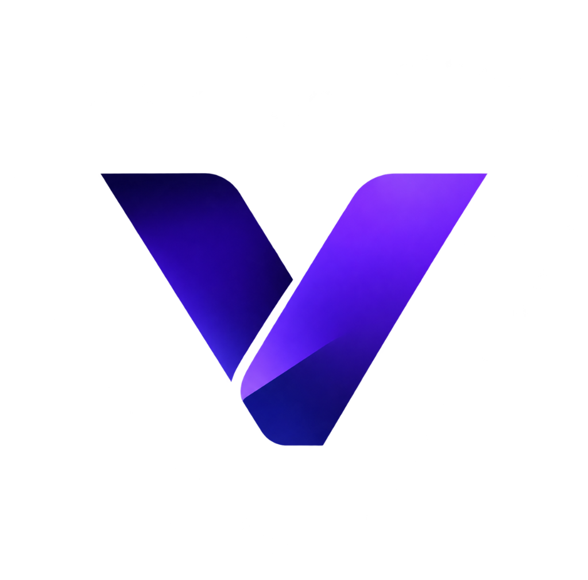
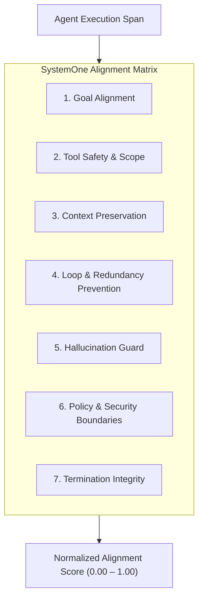

<div align="center">



# VYRONIQ

### Autonomous AI Agent Observability, Security & Behavioral Evaluation Platform

[](https://opensource.org/licenses/MIT)
[](https://python.org)
[](https://fastapi.tiangolo.com)
[](https://nextjs.org)
[](https://elastic.co)
[](https://ollama.com)
[](https://docker.com)

<br/>

> **VYRONIQ brings comprehensive visibility and evaluation to autonomous AI agents. It continuously monitors agent behavior, evaluates goal alignment, analyzes decision-making, detects behavioral deviations, and provides actionable insights into agent execution, helping ensure agents operate as intended.**

<br/>

[🚀 Quick Start](#-quick-start) •
[🧩 Hooks Configuration](#-step-2-configure-antigravity-hooks-hooksjson) •
[📊 Architecture](#-architecture--data-flow) •
[🎯 Alignment Matrix](#-systemone-alignment-evaluation) •
[⚙️ Model Matrix](#-supported-hardware--decision-models) •
[🔍 Diagnostics](#-inspection-logs--troubleshooting)

</div>

---

## ✨ Key Features

<table>
  <tr>
    <td width="50%">
      <h3>🔍 Deep Agent Observability</h3>
      <p>Non-intrusively captures complete agent lifecycle events: <code>SessionStart</code>, <code>PreToolUse</code>, <code>PostToolUse</code>, <code>PreInvocation</code>, <code>PostInvocation</code>, and <code>Stop</code>.</p>
    </td>
    <td width="50%">
      <h3>🎯 SystemOne Alignment Evaluation</h3>
      <p>Continuous 7-axis behavioral scoring and goal drift detection powered by dedicated local Ollama decision models (e.g. <code>tev1:4b</code>, <code>tev1:0.8b</code>, <code>nimble</code>).</p>
    </td>
  </tr>
  <tr>
    <td width="50%">
      <h3>🌲 Interactive DAG Spans & Flow Trace</h3>
      <p>Inspect multi-turn hierarchical execution trees, tool call parameters, output payloads, and step-level token consumption with cache hit rates.</p>
    </td>
    <td width="50%">
      <h3>⚡ Real-Time Next.js Dashboard</h3>
      <p>Modern glassmorphism interface featuring live telemetry streaming, model switch audits, executive KPI bento grids, and <code>⌘K</code> Command Palette.</p>
    </td>
  </tr>
  <tr>
    <td width="50%">
      <h3>🛡️ Security & Deviation Detection</h3>
      <p>Audit tool usage parameters, sensitive file operations, command execution patterns, and unexpected prompt deviations before escalation.</p>
    </td>
    <td width="50%">
      <h3>🐳 1-Click Containerized Stack</h3>
      <p>Production-ready Docker Compose orchestration bringing up Elasticsearch, FastAPI backend, and Next.js frontend seamlessly.</p>
    </td>
  </tr>
</table>

---

## 📊 Architecture & Data Flow

```text
┌────────────────────────────────────────────────────────┐
│               Autonomous Agent Runtime                │
│                 (Antigravity CLI / IDE)                │
└───────────────────────────┬────────────────────────────┘
                            │ Hooks Triggered
                            ▼
┌────────────────────────────────────────────────────────┐
│     hooks.json  ──▶  events/antigravity_events.py       │
│  (Extracts payload, transcripts & context metadata)    │
└───────────────────────────┬────────────────────────────┘
                            │ HTTP POST (JSON Event)
                            ▼
┌────────────────────────────────────────────────────────┐
│               FastAPI Backend (:8000)                  │
│       (Normalizes, dedupes, indexes & analyzes)        │
└──────────────┬──────────────────────────┬──────────────┘
               │                          │
               ▼ Index Telemetry          ▼ Alignment Prompt
┌────────────────────────┐      ┌────────────────────────┐
│  Elasticsearch (:9200) │      │  Ollama Engine (:11434)│
│  Full-text audit logs  │      │  Decision Models       │
│  & persistent traces   │      │  (SystemOne Evaluator) │
└──────────────┬─────────┘      └────────────────────────┘
               │
               ▼ REST API / Polling Sync
┌────────────────────────────────────────────────────────┐
│             VYRONIQ Web Console (:3000)                │
│   (Next.js 15 + React 19 + Tailwind CSS + Framer)      │
└────────────────────────────────────────────────────────┘
```

---

## 📋 Prerequisites

Before starting VYRONIQ, ensure you have:

- **[Docker & Docker Compose](https://www.docker.com/products/docker-desktop/)** installed and running.
- **[Ollama](https://ollama.com/)** installed and running on your host machine (`http://localhost:11434`).
- **Python 3.10+** available on your system path (to execute the hook scripts).

---

## 🚀 Quick Start

### 🔹 Step 1: Configure Environment (`.env`)

1. Clone or navigate to the repository and duplicate `.env.example`:
   ```bash
   cp .env.example .env
   ```

2. Open `.env` and configure your settings:
   ```env
   # Backend & Ollama Configuration
   BACKEND_URL=http://localhost:8000
   ELASTICSEARCH_URL=http://localhost:9200
   OLLAMA_HOST=http://localhost:11434
   DECISION_MODEL=tev1:4b
   SYSTEMONE_CONTEXT_WINDOW=8192

   # Frontend Configuration
   NEXT_PUBLIC_API_BASE=http://localhost:8000

   # Elasticsearch Settings
   ES_JAVA_OPTS=-Xms1g -Xmx1g
   ```

3. Ensure Ollama is running in the background and pull your chosen model:
   ```bash
   # Example: pulling your decision model
   ollama pull tev1:4b
   ```

---

### 🔹 Step 2: Configure Antigravity Hooks (`hooks.json`)

To capture live events from your agent runtime, configure your local Antigravity hooks file:

📍 **Target File Path:**
```text
C:\Users\<your username>\.gemini\config\hooks.json
```

Add the following configuration. **Replace `<path-to-your-project>`** with your absolute directory path to `ai_security_tool`:

```json
{
  "event-forwarder": {
    "enabled": true,
    "SessionStart": [
      {
        "type": "command",
        "command": "python <path-to-your-project>\\events\\antigravity_events.py SessionStart",
        "timeout": 10
      }
    ],

    "PreToolUse": [
      {
        "matcher": "*",
        "hooks": [
          {
            "type": "command",
            "command": "python <path-to-your-project>\\events\\antigravity_events.py PreToolUse",
            "timeout": 10
          }
        ]
      }
    ],

    "PostToolUse": [
      {
        "matcher": "*",
        "hooks": [
          {
            "type": "command",
            "command": "python <path-to-your-project>\\events\\antigravity_events.py PostToolUse",
            "timeout": 10
          }
        ]
      }
    ],

    "PreInvocation": [
      {
        "type": "command",
        "command": "python <path-to-your-project>\\events\\antigravity_events.py PreInvocation",
        "timeout": 10
      }
    ],
    "PostInvocation": [
      {
        "type": "command",
        "command": "python <path-to-your-project>\\events\\antigravity_events.py PostInvocation",
        "timeout": 10
      }
    ],
    "Stop": [
      {
        "type": "command",
        "command": "python <path-to-your-project>\\events\\antigravity_events.py Stop",
        "timeout": 10
      }
    ]
  }
}
```

<details>
<summary><b>💡 Path Formatting Tips</b> (Click to expand)</summary>

- **Windows:** Double escape backslashes in JSON:
  ```json
  "command": "python C:\\Users\\jeyar\\Projects\\ai_security_tool\\events\\antigravity_events.py SessionStart"
  ```
- **macOS / Linux:** Use regular forward slashes:
  ```json
  "command": "python /Users/username/projects/ai_security_tool/events/antigravity_events.py SessionStart"
  ```
</details>

---

### 🔹 Step 3: Launch Services with Docker Compose

Spin up the entire platform (Elasticsearch, FastAPI backend, and Next.js frontend) with one command:

```bash
docker-compose up -d
```

Verify that all three containers are healthy:
```bash
docker-compose ps
```

| Service | Container Name | Port | Description |
| :--- | :--- | :--- | :--- |
| **Elasticsearch** | `elasticsearch` | `9200` | Telemetry database & indexer |
| **FastAPI Backend** | `ai-security-backend` | `8000` | Analytics API & Ollama SystemOne evaluator |
| **Next.js UI** | `ai-security-frontend` | `3000` | Real-time observability dashboard |

---

### 🔹 Step 4: Open VYRONIQ Console

Navigate to **[http://localhost:3000](http://localhost:3000)** in your browser.

Now, simply start using Antigravity! Every prompt, tool execution, model change, and plan step will stream in real time to the dashboard.

---

## ⚙️ Supported Hardware & Ollama Decision Models

VYRONIQ utilizes **Ollama System One (`/v1/systemone`) Decision Models** rather than conversational autoregressive LLMs. 

### 💡 Why Decision Models Instead of Generative LLMs?
* **Instant Evaluation:** Instead of slowly streaming generated text token-by-token, decision models evaluate agent state, goal deviations, and tool safety in a **single forward pass**.
* **Zero Token Bloat & Low Latency:** Directly outputs structured answers: `choice` classifications, `score` rubric ratings (0–4), and `noul` (yes/no probability distributions).
* **Minimal Memory Overhead:** Because decision models do not maintain conversational KV-caches, they run efficiently on constrained hardware with deterministic reliability.

### 📊 Decision Model Hardware Specifications

Choose the decision model that matches your system's available memory:

| Hardware Tier | Free RAM / VRAM | Model Name | Parameter Size | Disk Footprint | Recommended `.env` Setting |
| :--- | :--- | :--- | :--- | :--- | :--- |
| **Ultra-Lightweight (CPU / Entry Laptop)** | 2 GB – 4 GB | `tev1:0.8b` (Together AI)<br/>`d1` (Liquid AI) | 0.8B<br/>~1B | ~812 MB<br/>~1.2 GB | `DECISION_MODEL=tev1:0.8b` |
| **Standard (Mainstream CPU / 8GB RAM)** | 6 GB – 8 GB | `tev1:4b` *(Default)* (Together AI) | 4B | ~4.5 GB | `DECISION_MODEL=tev1:4b` |
| **Balanced / Pro (Mid GPU / 12–16GB VRAM)** | 12 GB – 14 GB | `nimble` / `nimble:9b` (Bespoke Labs)<br/>`clef-flash` (Cloudflare) | 9B<br/>9B | ~9.5 GB<br/>~10 GB | `DECISION_MODEL=nimble` |
| **Workstation (High GPU / 24–32GB+ VRAM)** | 24 GB – 32 GB+ | `clef` (Cloudflare Multimodal)<br/>`d3` (Liquid AI) | 27B<br/>14B+ | ~22 GB<br/>~15 GB | `DECISION_MODEL=clef` |

### 📥 Pulling Decision Models via Ollama CLI

Pull your chosen model before launching the container stack:

```bash
# Recommended default (4B parameters — great balance of speed & evaluation depth)
ollama pull tev1:4b

# For ultra-low resource setups or laptops with under 8GB RAM
ollama pull tev1:0.8b

# For high-accuracy 9B classification & enterprise scoring (16GB+ RAM/VRAM)
ollama pull nimble
```

---

## 🎯 SystemOne Alignment Evaluation

VYRONIQ continuously evaluates agent actions across 7 core alignment axes:



Each interaction is graded on:
- **`noul`**: Normal operational threshold.
- **`score`**: 0–4 granular rating of agent decision precision.
- **`choice`**: Probability distribution over alternative safe trajectories.

---

## 🔍 Inspection Logs & Troubleshooting

If you need to verify hook execution or debug a failure:

### 1. Antigravity Hook Logs
All hook triggers and forwarding requests are logged locally to:
```text
C:\Users\<your username>\.gemini\config\app.log
```
Check this file to confirm payloads are sent successfully to the backend without blocking the agent.

### 2. Docker Service Logs
```bash
# Stream all container logs
docker-compose logs -f

# Inspect only the backend analysis service
docker-compose logs -f backend

# Inspect frontend rendering logs
docker-compose logs -f frontend

# Inspect Elasticsearch storage logs
docker-compose logs -f elasticsearch
```

---

## 🗺️ Roadmap & Deployment

- [x] **v0.1.0** — Antigravity lifecycle hooks, SystemOne alignment evaluation, Elasticsearch indexing, Next.js interactive console, and Docker Compose stack.
- [ ] **v0.2.0** — Advanced deployment guide (Kubernetes / Helm charts, cloud VPS hosting, and multi-agent cluster aggregation).
- [ ] **v0.3.0** — Real-time proactive intervention & agent policy interceptor (pause / redirect drifting runs).

---

## 📄 License

This project is licensed under the **MIT License**. See the [LICENSE](LICENSE) file for details.
